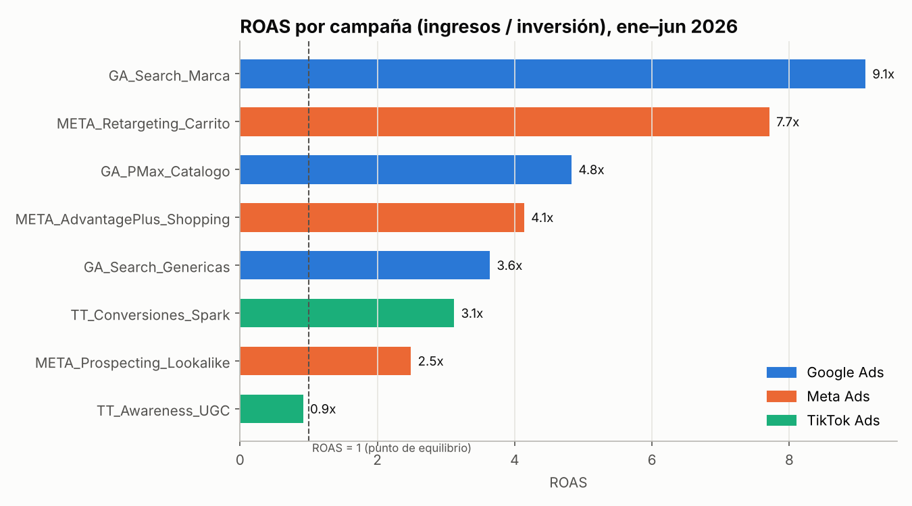
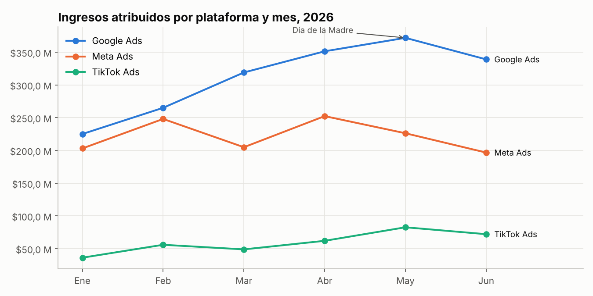
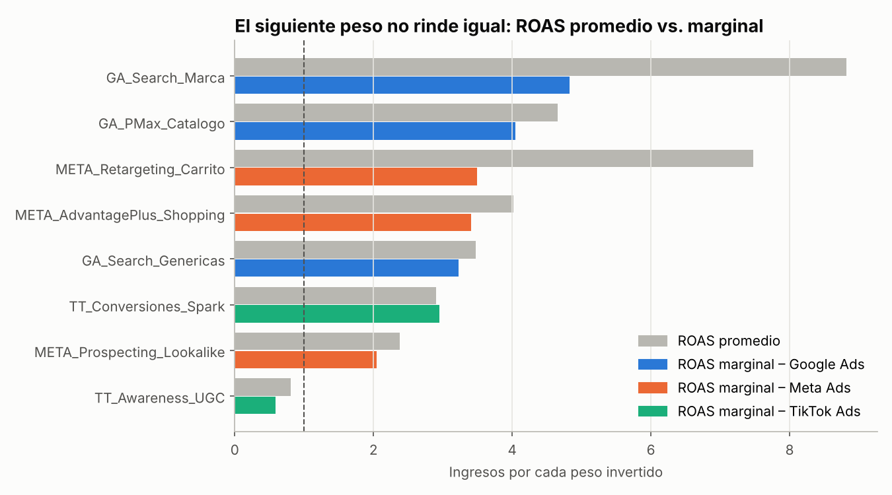
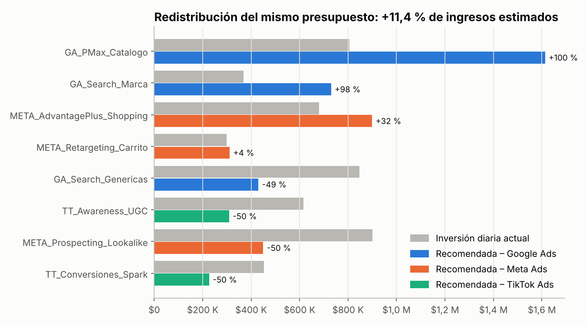

# 📊 Proyecto 1 · Desempeño de campañas multicanal y optimización de presupuesto

**Plataformas:** Google Ads · Meta Ads · TikTok Ads  
**Herramientas:** Python (pandas, NumPy, SciPy, Matplotlib) · SQL (SQLite) · Power BI (DAX)  
**Empresa:** Kumbre Store, e-commerce de moda y hogar en Colombia (**empresa ficticia, datos simulados**)  
**Periodo:** enero – junio 2026 · 8 campañas · 1.448 registros diarios

---

## 🎯 Pregunta de negocio

> *"Invertimos $899 millones en pauta digital en el semestre. ¿Qué campañas generan retorno, cuáles no, y cómo deberíamos repartir el mismo presupuesto para vender más?"*

## 📌 Resultados clave

| Indicador | Resultado |
|---|---|
| Inversión total | **$899,1 M COP** |
| Ingresos atribuidos | **$3.561,1 M COP** |
| ROAS global | **3,96x** |
| Conversiones / CPA | **24.901** compras · **$36.109** por compra |
| Mejor campaña (ROAS) | `GA_Search_Marca` **9,11x** |
| Peor campaña (ROAS) | `TT_Awareness_UGC` **0,92x** (por debajo del punto de equilibrio) |
| Temporada Día de la Madre | Ingreso diario **+75 %** ($32,4 M vs. $18,4 M) y ROAS 5,13x vs. 3,81x |
| **Redistribuir el mismo presupuesto** | **+11,4 % de ingresos estimados** (≈ $2,2 M COP más por día) sin invertir un peso adicional |

### KPIs por plataforma

| Plataforma | Inversión | Ingresos | ROAS | CPA | CTR | CVR | % de la inversión |
|---|---:|---:|---:|---:|---:|---:|---:|
| Google Ads | $366,0 M | $1.871,6 M | **5,11x** | $29.440 | 3,50 % | 1,95 % | 40,7 % |
| Meta Ads | $340,0 M | $1.331,5 M | 3,92x | $35.530 | 1,47 % | 1,94 % | 37,8 % |
| TikTok Ads | $193,2 M | $358,0 M | 1,85x | $66.609 | 1,01 % | 0,85 % | 21,5 % |





## 🔍 Análisis: el ROAS promedio engaña

Una campaña con ROAS alto no necesariamente debe recibir más dinero: lo que importa es el **ROAS marginal**, es decir, cuánto devuelve el *siguiente* peso invertido. Para medirlo estimé una curva de respuesta por campaña con regresión log-log, controlando fines de semana, enero y la temporada del Día de la Madre:

$$\ln(\text{ingresos}) = \ln(a) + b \cdot \ln(\text{inversión}) + \text{controles de temporada}$$

El coeficiente **b** es la elasticidad: si b = 0,55, duplicar la inversión solo aumenta los ingresos un 46 %, porque la campaña se satura.



- `META_Retargeting_Carrito` tiene ROAS promedio de 7,5x, pero su ROAS marginal cae a **3,5x**: la audiencia de carritos abandonados es pequeña y se agota rápido (b = 0,47).
- `GA_PMax_Catalogo` mantiene un ROAS marginal de **4,0x** (b = 0,87): todavía tiene espacio para crecer.
- `TT_Awareness_UGC` tiene un ROAS marginal de **0,6x**: cada peso adicional se pierde, *si se mide solo por ventas directas*.

## 💡 Recomendación de presupuesto

Con optimización no lineal (SciPy, SLSQP), redistribuí **el mismo presupuesto diario** para maximizar los ingresos. Como límite de prudencia, ninguna campaña sube más del 100 % ni baja más del 50 %:



| Acción | Campañas | Por qué |
|---|---|---|
| 🟢 **Escalar** | `GA_PMax_Catalogo` (+100 %), `GA_Search_Marca` (+98 %), `META_AdvantagePlus_Shopping` (+32 %) | Mayor ROAS marginal |
| 🟡 **Mantener** | `META_Retargeting_Carrito` (+4 %) | Rentable pero saturada |
| 🔴 **Reducir** | `META_Prospecting_Lookalike`, `GA_Search_Genericas`, `TT_Conversiones_Spark` (−50 %) | El dinero rinde más en otras campañas |
| ⚠️ **No apagar sin medir** | `TT_Awareness_UGC` (−50 %) | Su objetivo es **alcance**, no venta directa. Antes de recortarla, medir su aporte con atribución multitoque ([Proyecto 2](../02-embudo-ga4-atribucion/)) o un estudio de *brand lift* |

**Resultado estimado:** de $18,9 M a **$21,0 M COP de ingresos diarios (+11,4 %)** con la misma inversión.

### Límites del análisis (y cómo los validaría)

- **Search de marca** no se puede escalar al infinito: depende de cuánta gente busca "Kumbre". Antes de duplicar el presupuesto, revisaría el *impression share* en Google Ads.
- La curva se estimó con datos observados, no con un experimento. Validaría la recomendación con una **prueba geográfica** (subir presupuesto en una ciudad y comparar con otra) durante 3–4 semanas.
- `TT_Conversiones_Spark` dio b ≈ 1, es decir, no se detectó saturación. Se recorta porque otras campañas devuelven más por peso, no porque sea mala.

## 🧹 Calidad de datos (ETL)

Cada plataforma exporta en un formato distinto. El script `src/etl.py` las unifica y **detiene el proceso si un control falla**:

| Problema encontrado | Plataforma | Solución |
|---|---|---|
| Costo como texto con separador de miles ("1.234.567") | Google Ads | Conversión a número |
| 6 filas duplicadas | Meta Ads | `drop_duplicates()` |
| 4 conversiones vacías | TikTok Ads | Imputación: ingresos ÷ ticket promedio de la campaña |
| Fechas en formato AAAA/MM/DD | TikTok Ads | Estandarización a ISO 8601 |

Controles automáticos: clics ≤ impresiones, conversiones ≤ clics, sin gasto negativo, sin nulos, una fila por fecha y campaña. Ver [`outputs/reporte_calidad_datos.md`](outputs/reporte_calidad_datos.md).

## 🗂️ Estructura

```
01-campanas-multicanal-roas/
├── data/
│   ├── raw/                  # Exportaciones originales de cada plataforma (con errores)
│   └── processed/            # Tabla unificada (CSV) y base SQLite
├── src/
│   ├── generar_datos.py      # Simula las exportaciones (semilla fija = reproducible)
│   ├── etl.py                # Limpieza, unificación y controles de calidad
│   └── analisis.py           # SQL, curvas de respuesta, optimización y gráficos
├── sql/kpis_campanas.sql     # 6 consultas: KPIs, ranking, MoM con LAG, día de semana, temporada
├── dax/medidas_powerbi.dax   # Medidas para replicar el tablero en Power BI
└── outputs/                  # Gráficos, resultados SQL en CSV y resumen JSON
```

## ▶️ Cómo ejecutarlo

```bash
pip install -r ../requirements.txt
python src/generar_datos.py
python src/etl.py
python src/analisis.py
```

## 🧠 Habilidades demostradas

`Google Ads` `Meta Ads` `TikTok Ads` `ROAS` `CPA` `CTR` `CPC` `CPM` `CVR` `ETL` `Data Quality` `SQL` `Window Functions` `Python` `pandas` `Regresión log-log` `Optimización de presupuesto` `SciPy` `Power BI` `DAX` `Storytelling con datos`

---
*Datos 100 % simulados con fines de portafolio. Los parámetros (CPM, CTR, ticket promedio) se calibraron con rangos realistas para e-commerce en Colombia.*
