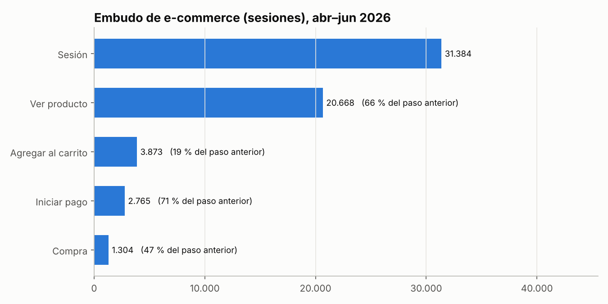
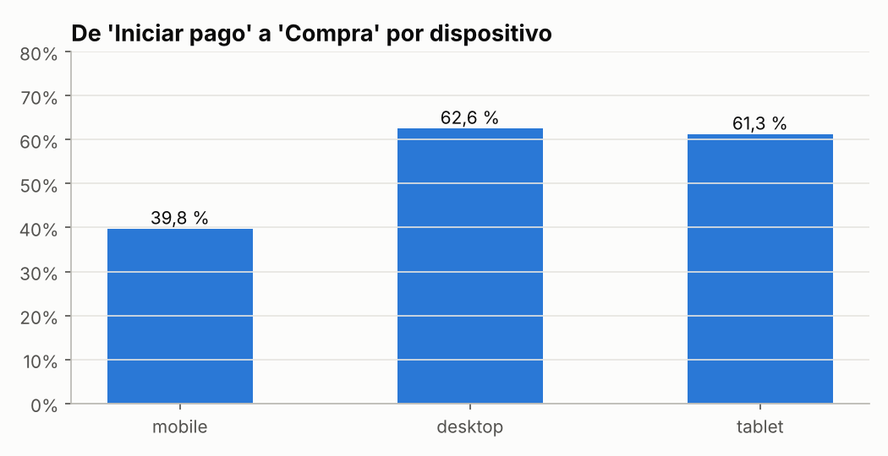
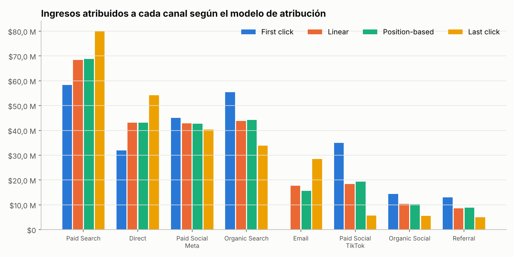
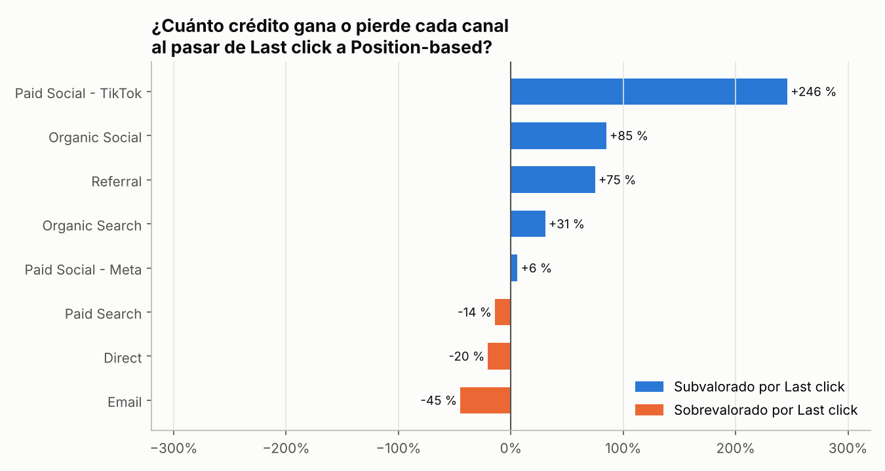

# 🔀 Proyecto 2 · Embudo de conversión GA4 y modelos de atribución multitoque

**Plataforma:** Google Analytics 4 (esquema de exportación a BigQuery)  
**Herramientas:** SQL (CTEs, `CASE`, `ROW_NUMBER`, `LAG`, `FIRST_VALUE`) · Python (pandas, Matplotlib)  
**Empresa:** Kumbre Store (**empresa ficticia, datos simulados**)  
**Periodo:** abril – junio 2026 · **59.994 eventos** · 18.000 usuarios · 31.384 sesiones · 1.304 compras

---

## 🎯 Preguntas de negocio

1. ¿En qué paso del embudo perdemos más clientes y cuánto dinero representa?
2. El informe por defecto le da todo el crédito al **último clic**. ¿Qué canales quedan subvalorados con ese criterio?

## 📌 Resultados clave

| Indicador | Resultado |
|---|---|
| Tasa de conversión por sesión | **4,15 %** |
| Tasa de conversión por usuario | **7,24 %** |
| Ingresos del trimestre | **$253,1 M COP** · ticket promedio $194.096 |
| Compras con más de un canal en el camino | **72,4 %** (2,48 visitas en promedio antes de comprar) |
| Tiempo hasta la compra | mediana **3 días** · promedio 5,5 días |
| Mayor fuga del embudo | **Ver producto → Agregar al carrito: 81 % abandona** |
| Problema de checkout en móvil | Solo **39,8 %** de quienes inician el pago en móvil terminan la compra (62,6 % en escritorio) |
| Canal más subvalorado por Last click | **TikTok: +246 %** de crédito con el modelo Position-based |

## 1️⃣ Embudo de conversión



| Paso | Sesiones | % del total | Abandono vs. paso anterior |
|---|---:|---:|---:|
| Sesión | 31.384 | 100 % | – |
| Ver producto | 20.668 | 65,9 % | 34,1 % |
| Agregar al carrito | 3.873 | 12,3 % | **81,3 %** |
| Iniciar pago | 2.765 | 8,8 % | 28,6 % |
| Compra | 1.304 | 4,2 % | **52,8 %** |

### El checkout en móvil es el problema más costoso



El 68 % del tráfico es móvil, pero allí más de la mitad de quienes inician el pago abandonan. Las tasas de agregar al carrito son similares en móvil y escritorio: **el problema no es el interés, es el formulario de pago**.

**Tamaño de la oportunidad:** si el checkout móvil pasara de 39,8 % a un objetivo conservador de 50 % (todavía por debajo del 62,6 % de escritorio):  
1.870 checkouts × 10,2 puntos = **191 compras adicionales × $194.096 ≈ $37 M COP más por trimestre**.

**Recomendaciones:** pago en un solo paso, autocompletar dirección, billeteras móviles (Nequi, Daviplata, PSE) y guardar el carrito para usuarios no registrados. Validar con un A/B test (ver [Proyecto 3](../03-ab-testing-email/)).

## 2️⃣ Modelos de atribución

Reconstruí el recorrido de canales de cada comprador hasta su primera compra y repartí el ingreso con 5 modelos:

| Modelo | Regla |
|---|---|
| **First click** | 100 % al canal que trajo al usuario la primera vez |
| **Last click** | 100 % al último canal antes de comprar |
| **Linear** | Partes iguales entre todos los canales del camino |
| **Position-based** | 40 % al primero, 40 % al último y 20 % repartido entre los del medio |
| **Time decay** | Más peso a los canales cercanos a la compra (vida media de 7 días) |



| Canal | First click | Linear | Position-based | Last click | Position-based vs. Last click |
|---|---:|---:|---:|---:|---:|
| Paid Search | $58,3 M | $68,4 M | $68,9 M | $80,1 M | −14 % |
| Direct | $32,0 M | $43,2 M | $43,1 M | $54,1 M | −20 % |
| Paid Social – Meta | $45,0 M | $42,8 M | $42,7 M | $40,3 M | +6 % |
| Organic Search | $55,4 M | $43,8 M | $44,3 M | $33,9 M | +31 % |
| Email | $0 | $17,7 M | $15,7 M | $28,5 M | **−45 %** |
| Paid Social – TikTok | $35,0 M | $18,4 M | $19,4 M | $5,6 M | **+246 %** |
| Organic Social | $14,4 M | $10,3 M | $10,2 M | $5,5 M | +85 % |
| Referral | $13,0 M | $8,6 M | $8,8 M | $5,0 M | +75 % |



### Hallazgos

- **TikTok abre ventas que otros cierran.** Atrae al 17 % de los usuarios nuevos, pero casi nunca es el último clic. Con Last click parece un canal que no vende ($5,6 M). Con Position-based aporta **$19,4 M, 3,5 veces más**. Esto explica el ROAS de 0,92x de `TT_Awareness_UGC` en el [Proyecto 1](../01-campanas-multicanal-roas/): **apagarla cortaría la entrada del embudo**.
- **Email y Direct están sobrevalorados por Last click.** Email nunca trae usuarios nuevos (0 en First click): cierra ventas de personas que ya conocían la marca. Sigue siendo valioso, pero no genera demanda nueva.
- **Ruta típica:** `Paid Social – Meta → Paid Search` (34 compras) y `TikTok → Paid Search` (21 compras). Las redes generan el interés y Google lo captura.

### Rutas de conversión más frecuentes

| Ruta | Compras | Ingresos |
|---|---:|---:|
| Paid Search | 102 | $20,0 M |
| Organic Search | 100 | $19,2 M |
| Direct | 57 | $10,9 M |
| Paid Social – Meta | 50 | $8,4 M |
| Paid Social – Meta → Paid Search | 34 | $7,4 M |
| Organic Search → Paid Search | 28 | $5,1 M |
| Paid Search → Paid Search | 27 | $5,7 M |
| Organic Search → Direct | 25 | $4,6 M |
| Paid Social – Meta → Paid Social – Meta | 21 | $4,0 M |
| Paid Social – TikTok → Paid Search | 21 | $5,1 M |

## 💡 Recomendaciones

1. **Optimizar el checkout móvil** (≈ $37 M COP adicionales por trimestre).
2. **Evaluar TikTok y Meta con un modelo multitoque**, no con Last click, al decidir presupuesto.
3. **Usar Email para retención y recompra**, no como indicador de adquisición.
4. Configurar en GA4 el modelo **data-driven** y comparar sus resultados con este análisis.

## 🗂️ Estructura

```
02-embudo-ga4-atribucion/
├── data/ga4_events_export.csv     # Eventos con el esquema de GA4 → BigQuery (aplanado)
├── src/
│   ├── generar_datos.py           # Simulación de usuarios, sesiones y eventos (semilla fija)
│   └── analisis.py                # SQL + caminos de conversión + 5 modelos de atribución
├── sql/embudo_y_atribucion.sql    # Agrupación de canales, embudo, dispositivo, first/last click
└── outputs/                       # Gráficos, resultados SQL, atribución y rutas en CSV
```

**Columnas del dataset:** `event_date`, `event_timestamp`, `event_name`, `user_pseudo_id`, `ga_session_id`, `ga_session_number`, `session_source`, `session_medium`, `session_campaign`, `device_category`, `item_category`, `transaction_id`, `purchase_revenue`

## ▶️ Cómo ejecutarlo

```bash
python src/generar_datos.py
python src/analisis.py
```

## 🧠 Habilidades demostradas

`Google Analytics 4` `BigQuery schema` `Funnel analysis` `Attribution modeling` `Multi-touch attribution` `Customer journey` `SQL` `CTE` `Window Functions` `Python` `pandas` `CRO` `Data storytelling`

---
*Datos 100 % simulados con fines de portafolio.*
