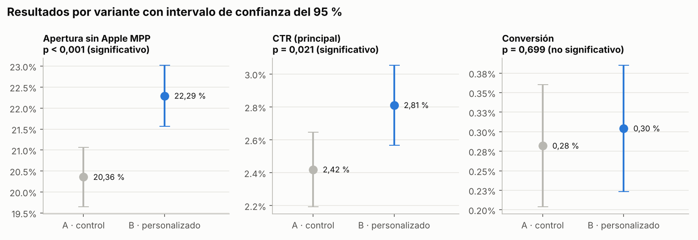
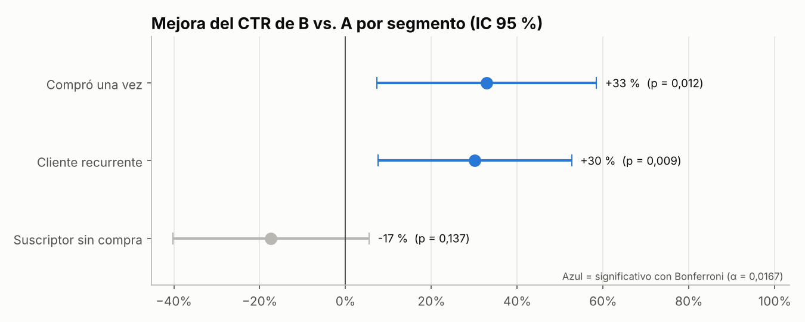

# ✉️ Proyecto 3 · A/B test de asunto en email marketing

**Plataforma:** HubSpot (exportación por destinatario, válida también para Mailchimp o Klaviyo)  
**Herramientas:** Python (SciPy, pandas, Matplotlib) · SQL (SQLite) · Estadística inferencial  
**Empresa:** Kumbre Store (**empresa ficticia, datos simulados**)  
**Campaña:** Día del Padre 2026 · envío del 12 de junio · **36.000 contactos** asignados al azar 50/50

---

## 🎯 Pregunta de negocio

> *"¿Un asunto personalizado con el nombre del cliente genera más clics que nuestro asunto promocional de siempre? ¿Debemos adoptarlo para toda la base?"*

| Variante | Asunto |
|---|---|
| **A · control** | Regalos para papá con 20 % OFF |
| **B · personalizado** | {Nombre}, el regalo perfecto para tu papá está aquí 🎁 |

## 📌 Resultados clave

| Métrica | A | B | Diferencia | p-valor | ¿Significativo? |
|---|---:|---:|---:|---:|:---:|
| **CTR (métrica principal)** | 2,42 % | **2,81 %** | **+16,2 %** (+0,39 pp) | 0,021 | ✅ |
| Apertura sin Apple MPP | 20,36 % | 22,29 % | +9,5 % | < 0,001 | ✅ |
| Conversión (compra / entregado) | 0,282 % | 0,304 % | +7,9 % | 0,699 | ❌ |
| Ingreso por destinatario | $396 | $464 | +$68 (IC 95 %: −$104 a +$246) | 0,45 | ❌ |
| Tasa de bajas | 0,130 % | 0,169 % | +0,04 pp | 0,338 | ❌ (sin daño detectable) |



**Decisión:** ✅ **adoptar el asunto personalizado para clientes que ya compraron** y seguir probando con los suscriptores sin compra. B genera unos **141 clics adicionales en cada envío a 36.000 contactos**.

## 🧪 Cómo se hizo (paso a paso)

### 0. Diseño antes de enviar

- Métrica principal definida **antes** del envío: **CTR = clics ÷ entregados**.
- Tamaño de muestra: con un CTR histórico de 2,4 %, para detectar una mejora relativa de **20 %** (α = 0,05, poder = 80 %) se necesitaban **17.511 contactos por grupo**. Se lograron 17.729 (A) y 17.751 (B) ✔️

### 1. Control de calidad del experimento

- **Sample Ratio Mismatch (SRM):** prueba chi-cuadrado sobre los entregados por variante, p = 0,907. La asignación se mantuvo 50/50 y el test es confiable.

### 2. ¿Por qué la apertura no es la métrica principal?

Apple Mail Privacy Protection abre los correos automáticamente para proteger la privacidad. En esta base, **el 30 % de los entregados (10.592) aparecen como "abiertos" sin que nadie los haya leído**:

| Grupo | Tasa de apertura reportada | CTR |
|---|---:|---:|
| Apertura automática (Apple MPP) | 100 % | 2,43 % |
| Resto de destinatarios | 21,3 % | 2,70 % |

HubSpot reporta **44 %–45 % de apertura**, pero la apertura real ronda el **20 %–22 %**. Por eso el test se decide con los **clics**, que sí requieren una acción humana.

### 3. Pruebas estadísticas

- **Proporciones (CTR, apertura, conversión, bajas):** prueba z de dos proporciones con intervalo de confianza del 95 %.
- **Ingreso por destinatario:** **bootstrap con 10.000 remuestreos**, porque más del 99 % de los valores son cero y la distribución no es normal.

### 4. Efecto por segmento (con corrección de Bonferroni)

Al probar 3 segmentos aumenta el riesgo de falsos positivos, así que el umbral de significancia baja de 0,05 a **0,0167**:



| Segmento | CTR A | CTR B | Mejora | p-valor | Conclusión |
|---|---:|---:|---:|---:|---|
| Cliente recurrente | 4,27 % | 5,56 % | **+30 %** | 0,009 | ✅ Funciona |
| Compró una vez | 2,68 % | 3,55 % | **+33 %** | 0,012 | ✅ Funciona |
| Suscriptor sin compra | 1,48 % | 1,22 % | −17 % | 0,137 | ⚪ Sin efecto claro |

**Hallazgo:** la personalización funciona con quienes **ya conocen la marca**. Para quien nunca ha comprado, ver su nombre no genera confianza adicional. El efecto promedio de +16 % esconde dos públicos que reaccionan distinto.

## ⚠️ Límites y próximos pasos

1. **El efecto observado (+16 %) es menor que el efecto mínimo para el que se diseñó el test (+20 %).** El resultado es significativo, pero las estimaciones en ese rango tienden a exagerar el efecto real (*winner's curse*). Conviene **confirmarlo en el próximo envío** antes de proyectar ingresos.
2. **El ingreso no tiene suficiente poder estadístico:** con ~50 compras por grupo no se puede detectar una diferencia en ventas. Para medirlo habría que acumular varios envíos o usar una muestra mucho más grande.
3. **Nuevo test para suscriptores sin compra:** probar un asunto centrado en el beneficio (por ejemplo, envío gratis en la primera compra) en lugar de la personalización.

## 🗂️ Estructura

```
03-ab-testing-email/
├── data/hubspot_ab_test_export.csv   # 36.000 filas, una por destinatario
├── src/
│   ├── generar_datos.py              # Simulación del envío (semilla fija)
│   └── analisis.py                   # Diseño, SRM, pruebas z, bootstrap, Bonferroni, gráficos
├── sql/resultados_ab.sql             # Resumen por variante, segmento, dispositivo y efecto de Apple MPP
└── outputs/                          # Gráficos, pruebas en CSV y resumen JSON
```

## ▶️ Cómo ejecutarlo

```bash
python src/generar_datos.py
python src/analisis.py
```

## 🧠 Habilidades demostradas

`Email marketing` `HubSpot` `A/B testing` `Experimentación` `Tamaño de muestra` `Poder estadístico` `MDE` `Prueba z` `Intervalos de confianza` `Bootstrap` `Bonferroni` `Sample Ratio Mismatch` `Apple MPP` `SQL` `Python` `SciPy`

---
*Datos 100 % simulados con fines de portafolio.*
