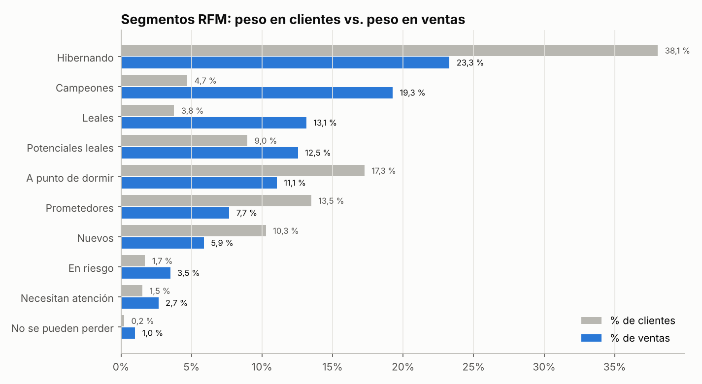
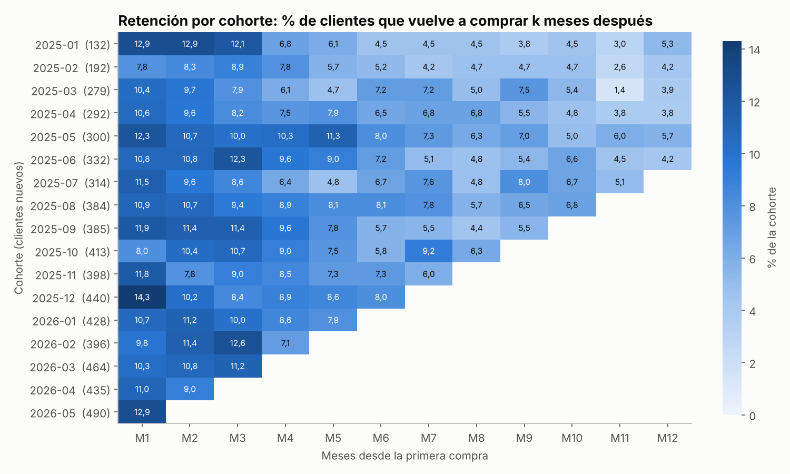
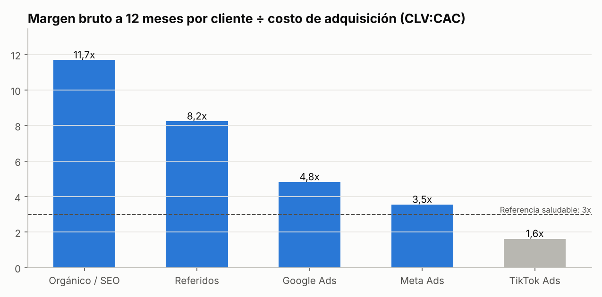

# 👥 Proyecto 4 · Segmentación RFM, retención por cohortes y CLV vs. CAC

**Plataformas:** exportación de Shopify / WooCommerce · activación en HubSpot, WhatsApp y Meta Ads  
**Herramientas:** SQL (CTEs, `NTILE`, funciones de ventana) · Python (pandas, Matplotlib) · Power BI (DAX)  
**Empresa:** Kumbre Store (**empresa ficticia, datos simulados**)  
**Periodo:** enero 2025 – junio 2026 · **6.500 clientes** · **10.966 pedidos** · $1.669,8 M COP en ventas netas

---

## 🎯 Preguntas de negocio

1. ¿Quiénes son nuestros mejores clientes y quiénes estamos a punto de perder?
2. ¿Qué tanto vuelven a comprar los clientes nuevos?
3. ¿Qué canal de adquisición trae clientes que **valen más de lo que cuestan**?

## 📌 Resultados clave

| Indicador | Resultado |
|---|---|
| Ventas netas / margen bruto | **$1.669,8 M** / **$732,3 M** (43,9 % de margen) |
| Ticket promedio | **$152.274** |
| Clientes que compraron solo una vez | **74,0 %** |
| Concentración | El **10 %** de clientes genera el **36,9 %** de las ventas; el 20 % genera el **52,5 %** |
| Campeones + Leales | **8,5 % de los clientes → 32,4 % de las ventas** |
| Recompra en los primeros 90 días | **21,5 %** de los clientes nuevos |
| Mejor canal (CLV:CAC) | **Orgánico / SEO 11,7x** · Referidos 8,2x |
| Canal por debajo de la referencia | **TikTok Ads 1,6x** (referencia saludable ≥ 3x) |

## 1️⃣ Segmentación RFM

| Letra | Qué mide | Cómo se puntúa (1 a 5) |
|---|---|---|
| **R** · Recencia | Días desde la última compra (corte: 30-jun-2026) | Quintiles: 5 = compró hace poco |
| **F** · Frecuencia | Número de pedidos | Regla de negocio: 1 · 2 · 3 · 4–5 · 6 o más. Los quintiles no sirven porque el 74 % tiene 1 pedido |
| **M** · Monto | Ventas netas acumuladas | Quintiles: 5 = gasta más |



| Segmento | Clientes | % clientes | % ventas | Recencia prom. | Pedidos prom. | Acción recomendada | Canal |
|---|---:|---:|---:|---:|---:|---|---|
| 🏆 Campeones | 306 | 4,7 % | **19,3 %** | 20 días | 6,4 | Programa VIP, acceso anticipado, pedir reseñas y referidos | Email + WhatsApp |
| 💙 Leales | 245 | 3,8 % | 13,1 % | 107 días | 5,6 | Venta cruzada (moda → hogar), puntos de fidelidad | Email |
| 🌱 Potenciales leales | 583 | 9,0 % | 12,5 % | 47 días | 2,4 | Incentivo para la 3.ª compra | Email + Meta |
| 🆕 Nuevos | 668 | 10,3 % | 5,9 % | 24 días | 1,0 | Bienvenida automatizada + cupón para la 2.ª compra en 30 días | Email automatizado |
| ✨ Prometedores | 877 | 13,5 % | 7,7 % | 85 días | 1,0 | Novedades de la categoría que compraron | Email + retargeting |
| 👀 Necesitan atención | 99 | 1,5 % | 2,7 % | 169 días | 3,0 | Oferta por tiempo limitado + encuesta | Email |
| 😴 A punto de dormir | 1.122 | 17,3 % | 11,1 % | 171 días | 1,1 | Contenido de valor + descuento moderado | Email + Meta |
| ⚠️ En riesgo | 111 | 1,7 % | 3,5 % | 309 días | 3,4 | Campaña "te extrañamos" con beneficio fuerte | Email + Meta |
| 🚨 No se pueden perder | 15 | 0,2 % | 1,0 % | 266 días | 7,0 | Contacto 1 a 1 con oferta exclusiva | WhatsApp / llamada |
| 💤 Hibernando | 2.474 | 38,1 % | 23,3 % | 359 días | 1,1 | Solo campañas de temporada; **excluir de la pauta paga** | Email masivo |

El archivo [`outputs/clientes_rfm_scores.csv`](outputs/clientes_rfm_scores.csv) tiene el segmento de cada cliente, listo para cargarlo en HubSpot como lista o en Meta como audiencia personalizada.

## 2️⃣ Retención por cohortes



- En promedio, solo el **11,1 %** de cada cohorte vuelve a comprar al mes siguiente, y después del mes 6 se estabiliza entre 4 % y 8 %.
- **El primer trimestre es la ventana crítica:** quien no recompra en 90 días difícilmente vuelve. Solo el 21,5 % lo hace.
- La cohorte de diciembre 2025 (compradores de Navidad) tuvo la mejor retención al mes 1 (14,3 %).

**Oportunidad:** si una secuencia de bienvenida logra que el **10 % adicional** de los segmentos *Nuevos* y *Prometedores* (1.545 clientes) haga una segunda compra:  
155 clientes × $152.274 ≈ **$23,6 M en ventas y $10,3 M en margen bruto**.

## 3️⃣ CLV vs. CAC por canal de adquisición

Margen bruto que deja cada cliente en sus **primeros 12 meses**, solo para clientes adquiridos hasta junio de 2025 que ya cumplieron un año:



| Canal | Clientes | Pedidos por cliente (12 m) | Margen 12 m por cliente | CAC | CLV:CAC |
|---|---:|---:|---:|---:|---:|
| Orgánico / SEO | 233 | 2,12 | $140.319 | $12.000* | **11,7x** |
| Referidos | 127 | 2,41 | $164.846 | $20.000* | **8,2x** |
| Google Ads | 427 | 2,11 | $142.044 | $29.440 | 4,8x |
| Meta Ads | 456 | 1,85 | $126.083 | $35.530 | 3,5x |
| TikTok Ads | 284 | 1,63 | $108.213 | $66.609 | **1,6x** |

\* *CAC de orgánico y referidos son supuestos (costo de contenido y bono por referido). El CAC de los canales pagos se tomó del CPA del [Proyecto 1](../01-campanas-multicanal-roas/).*

**Hallazgos:**
- **Los referidos son los clientes más valiosos** (2,41 pedidos y $164.846 de margen al año). Un programa de referidos tiene el mejor retorno.
- **TikTok trae clientes que compran menos y cuestan más.** Sin embargo, su CAC se calculó con Last click. Según el [Proyecto 2](../02-embudo-ga4-atribucion/), TikTok recibe 3,5 veces más crédito con atribución multitoque, así que su CLV:CAC real probablemente es mayor. La recomendación es optimizarlo, no apagarlo.

## 💡 Plan de acción priorizado

1. **Automatizar la secuencia de bienvenida** (días 0, 7, 21 y 45) para subir la recompra a 90 días: ≈ $10 M de margen adicional.
2. **Lanzar un programa de referidos** para Campeones y Leales (551 clientes que generan el 32 % de las ventas).
3. **Rescatar a los 126 clientes "En riesgo" y "No se pueden perder"** con contacto personalizado.
4. **Excluir a los "Hibernando" de la pauta paga** en Meta y Google para no gastar en clientes con baja probabilidad de volver.

## 🗂️ Estructura

```
04-segmentacion-rfm-clv/
├── data/
│   ├── clientes.csv              # 6.500 clientes: canal de adquisición, ciudad, primera compra
│   └── pedidos.csv               # 10.966 pedidos: categoría, ventas brutas, descuento, ventas netas, margen
├── src/
│   ├── generar_datos.py          # Simulación (semilla fija)
│   └── analisis.py               # RFM, segmentos, cohortes, CLV:CAC y gráficos
├── sql/rfm_cohortes.sql          # RFM base, cohortes, Pareto con NTILE, valor por canal
├── dax/medidas_rfm_powerbi.dax   # Columnas R/F/M, segmento y medidas para Power BI
└── outputs/                      # Gráficos, segmentos, scores por cliente y resumen JSON
```

## ▶️ Cómo ejecutarlo

```bash
python src/generar_datos.py
python src/analisis.py
```

## 🧠 Habilidades demostradas

`RFM` `Segmentación de clientes` `Cohort analysis` `Retención` `CLV` `CAC` `LTV:CAC` `Pareto` `CRM` `Shopify` `HubSpot` `Audiencias personalizadas` `SQL` `NTILE` `Python` `pandas` `Power BI` `DAX`

---
*Datos 100 % simulados con fines de portafolio.*
