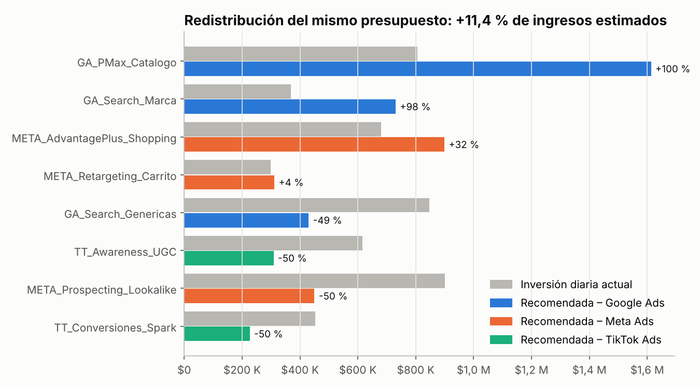
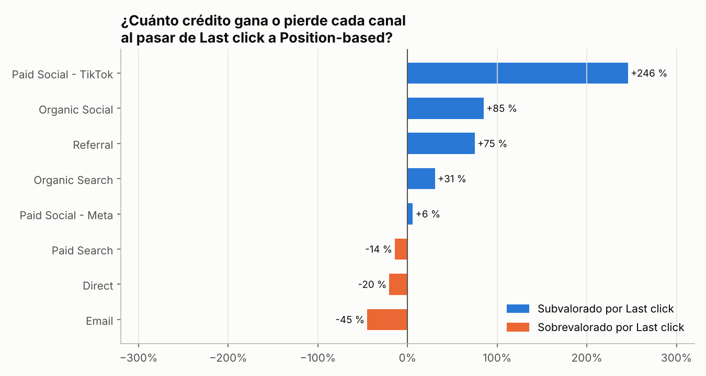
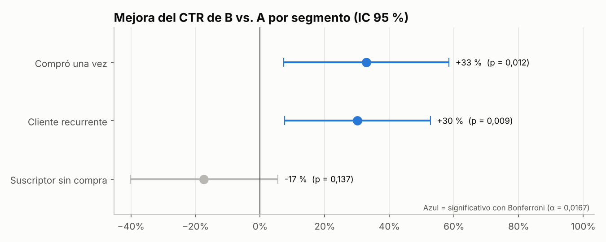
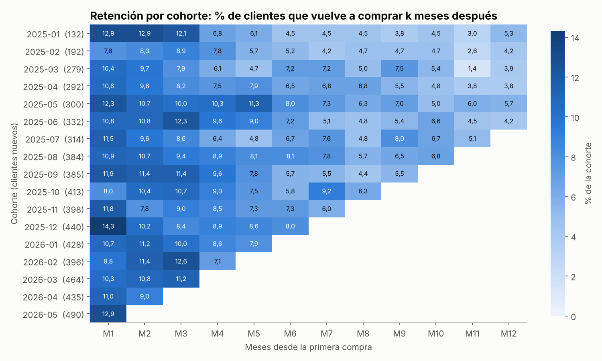

# 📈 Portafolio de Analítica de Marketing Digital

**Jeisson Marín Uribe** · Ingeniero de Sistemas e Industrial · Analista de Datos y Marketing Digital  
📍 Bogotá, Colombia · [LinkedIn](https://www.linkedin.com/in/jeisson-uribe-qa-data) · [GitHub](https://github.com/ujeisson-alt)

Cuatro proyectos de punta a punta que responden preguntas reales de un equipo de marketing digital: **dónde invertir, qué canal genera ventas, qué mensaje funciona y a qué clientes cuidar**. Cada proyecto incluye datos, limpieza, SQL, análisis en Python, medidas DAX para Power BI, gráficos y recomendaciones con su impacto estimado en pesos.

> ⚠️ **Todos los datos son simulados** y corresponden a *Kumbre Store*, un e-commerce ficticio de moda y hogar en Colombia. Los parámetros (CPM, CTR, ticket promedio, tasas de conversión) se calibraron con rangos realistas del mercado colombiano. Los scripts usan semillas fijas: cualquiera puede reproducir exactamente los mismos resultados.

---

## 🗂️ Proyectos

| # | Proyecto | Plataformas | Técnicas | Resultado principal |
|---|---|---|---|---|
| 1 | [**Campañas multicanal y optimización de presupuesto**](01-campanas-multicanal-roas/) | Google Ads · Meta Ads · TikTok Ads | ETL, SQL, regresión log-log, optimización (SciPy) | **+11,4 % de ingresos** redistribuyendo el mismo presupuesto |
| 2 | [**Embudo GA4 y atribución multitoque**](02-embudo-ga4-atribucion/) | Google Analytics 4 (esquema BigQuery) | Funnel analysis, 5 modelos de atribución, SQL con ventanas | Checkout móvil: **≈ $37 M COP por trimestre** de oportunidad; TikTok **+246 %** de crédito vs. Last click |
| 3 | [**A/B test de asunto en email**](03-ab-testing-email/) | HubSpot | Tamaño de muestra, prueba z, bootstrap, Bonferroni, SRM | Asunto personalizado: **+16,2 % de CTR** (p = 0,021), solo en clientes con compras previas |
| 4 | [**Segmentación RFM, cohortes y CLV:CAC**](04-segmentacion-rfm-clv/) | Shopify · HubSpot · Meta Audiences | RFM, retención por cohortes, Pareto, CLV vs. CAC | **8,5 % de los clientes genera el 32,4 % de las ventas**; referidos con CLV:CAC de 8,2x |

### Cómo se conectan

```
Proyecto 1 ─ TikTok Awareness tiene ROAS 0,92x con Last click... ¿la apagamos?
     │
     ▼
Proyecto 2 ─ No: TikTok trae al 17 % de los usuarios nuevos y recibe 3,5x más crédito con atribución multitoque
     │
     ▼
Proyecto 4 ─ Pero sus clientes compran menos (CLV:CAC 1,6x) → optimizar la segmentación, no apagar
     │
     ▼
Proyecto 3 ─ Para retenerlos, el mensaje personalizado funciona... solo con quien ya compró
```

---

## 📊 Vista previa

| Optimización de presupuesto | Atribución multitoque |
|---|---|
|  |  |
| **A/B test por segmento** | **Retención por cohortes** |
|  |  |

---

## 🧠 Habilidades

| Área | Herramientas y conceptos |
|---|---|
| **Pauta digital** | Google Ads, Meta Ads, TikTok Ads · ROAS, CPA, CTR, CPC, CPM, CVR · ROAS marginal · asignación de presupuesto |
| **Analítica web** | Google Analytics 4, esquema BigQuery · embudos · atribución (First, Last, Linear, Position-based, Time decay) |
| **CRM y email** | HubSpot · A/B testing · Apple Mail Privacy Protection · segmentación RFM · cohortes · CLV / CAC |
| **Datos** | SQL (CTEs, `ROW_NUMBER`, `LAG`, `NTILE`, `FIRST_VALUE`) · Python (pandas, NumPy, SciPy, Matplotlib) · ETL y calidad de datos |
| **BI** | Power BI · DAX (inteligencia de tiempo, `RANKX`, segmentación RFM) |
| **Estadística** | Regresión, pruebas de hipótesis, intervalos de confianza, bootstrap, poder estadístico, corrección por comparaciones múltiples |

---

## ▶️ Ejecutar todo

```bash
git clone https://github.com/ujeisson-alt/marketing-analytics-portfolio.git
cd marketing-analytics-portfolio
pip install -r requirements.txt
python run_all.py
```

`run_all.py` regenera los datos, ejecuta el ETL, las consultas SQL y los análisis, y vuelve a crear todos los gráficos (tarda menos de 1 minuto).

## 📁 Estructura del repositorio

```
marketing-analytics-portfolio/
├── 01-campanas-multicanal-roas/   # Google Ads + Meta Ads + TikTok Ads
├── 02-embudo-ga4-atribucion/      # GA4: embudo y atribución
├── 03-ab-testing-email/           # HubSpot: experimento de asunto
├── 04-segmentacion-rfm-clv/       # CRM: RFM, cohortes, CLV:CAC
├── estilo.py                      # Estilo común de gráficos (paleta apta para daltonismo)
├── run_all.py                     # Ejecuta los 4 proyectos de principio a fin
└── requirements.txt
```

Cada carpeta sigue la misma estructura: `data/` · `src/` · `sql/` · `dax/` · `outputs/` · `README.md`.

---

📬 ¿Hablamos? Escríbeme por [LinkedIn](https://www.linkedin.com/in/jeisson-uribe-qa-data).
